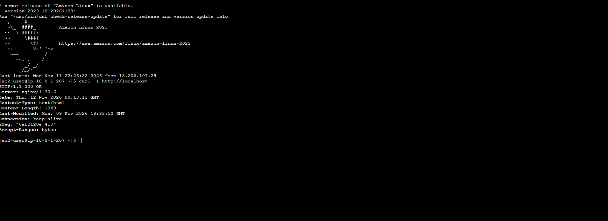

## AWS VPC Infrastructure with Terraform

## Project Overview
Built AWS networking infrastructure using Terraform and deployed an EC2 web server running Nginx with a custom cloud engineering portfolio webpage.

## AWS Services and Tools
- Amazon VPC
- Public and private subnets
- Internet Gateway
- Route tables and associations
- EC2 and security groups
- Terraform
- Amazon Linux 2023
- Nginx

## What I Built
1. Created a custom VPC using Terraform.
2. Configured public and private subnets.
3. Attached an Internet Gateway and configured public routing.
4. Created a security group for the web server.
5. Launched an Amazon Linux 2023 EC2 instance.
6. Installed Nginx and deployed a custom portfolio webpage.
7. Validated and applied Terraform infrastructure changes.

## Skills Demonstrated
- Infrastructure as Code
- AWS networking and routing
- Cloud security fundamentals
- Linux web server deployment
- Infrastructure troubleshooting

## Project Screenshots
Screenshots of the AWS infrastructure and deployment will be added here.

## Cost Management
AWS resources should be stopped or destroyed when no longer needed to minimize charges.

## Nginx Web Server Verification

### HTTP Connectivity Test

Connected to my Amazon Linux 2023 EC2 instance using EC2 Instance Connect.

Ran the following command:

`curl -I http://localhost`

### Test Results

HTTP/1.1 200 OK

Server: nginx/1.30.6

Content-Type: text/html

### What This Proves

The HTTP 200 OK response confirms that my Nginx web server successfully responded to a local HTTP request.

### Verification Screenshot

### Skills Demonstrated

- AWS EC2 administration
- Linux command-line troubleshooting
- Nginx web server testing
- HTTP connectivity verification

